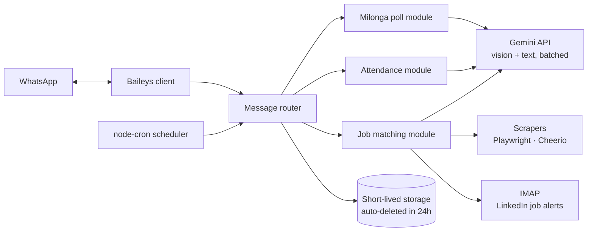

<h1 align="center">🤖 WhatsApp AI Assistant</h1>

  Three LLM-powered automations in a single WhatsApp bot: event polls for a tango community, class attendance tracking and CV-based job matching.

  
  
  
  
  
  

> 🔒 **The source code for this project is private.** This repository is a showcase of what it does and how it's built. I'm happy to walk through the code during an interview.

---

## 🎬 Demo

<!-- DEMO VIDEO: drag the .mp4 file onto the line below -->

https://github.com/user-attachments/assets/bedfac3c-c9ea-4c6d-86dc-e3150d48c508

---

## ✨ Features

### 1. 💃 The milonga list builds itself
Tango schools announce their events in Instagram stories. The bot reads each story image with AI (name, venue, date and time), merges it with the weekly schedule, cancellations and time changes, and posts a WhatsApp poll to the community group every day at 18:00.

### 2. 🎓 The instructor knows who's coming
Every class day the class group gets an attendance poll at noon. At 17:00 members who haven't voted get a private message, and free-text replies such as *"Can't make it tonight, stuck at work"* are understood by the LLM. At 19:00 the instructor receives a summary of who is coming, who isn't and who hasn't replied.

### 3. 💼 Hundreds of listings, a few good picks
Kariyer.net listings and LinkedIn job-alert emails are filtered (last 7 days, location, already-applied excluded), compared with the CV and scored **0–100**. Only the best matches are sent on WhatsApp, and a **cover letter tailored to the posting** is generated on request.

---

## 🏗️ Architecture

---

## 🧠 Key Engineering Decisions

| Challenge | Solution |
|---|---|
| WhatsApp poll votes are end-to-end encrypted | **AES-GCM decryption** of poll votes, matched back to hidden option IDs |
| Free-tier AI quota limits | Listings are scored in **batches**, cutting AI calls by **5×** so it runs on the free tier |
| Handling personal data responsibly | Votes and replies are **deleted within 24 hours**; message contents are never logged |
| Messy, free-form human replies | LLM-based intent parsing instead of rigid keyword matching |
| Reliability | **28 automated tests**; parser and scraper tests are built on samples from real pages |
| Respecting platform rules | **0 captcha bypasses**: platform rules are respected and the final step is always the user's |

---

## 🛠️ Tech Stack

- **Runtime:** Node.js, Express
- **WhatsApp:** Baileys (WhatsApp Web protocol)
- **AI:** Google Gemini API (vision + text), prompt engineering
- **Scraping:** Playwright, Cheerio
- **Integrations:** IMAP (job alert emails)
- **Scheduling:** node-cron
- **Development:** AI-assisted development with Claude Code

---

## 👩‍💻 Author

**Ayla Karacı**, Senior .NET Full Stack Developer
[LinkedIn](https://www.linkedin.com/in/ayla-karaci-3a709918a/) · [Email](mailto:karaciayla@gmail.com) · [GitHub](https://github.com/AylaKaraci)
